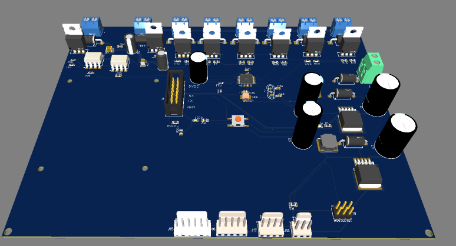
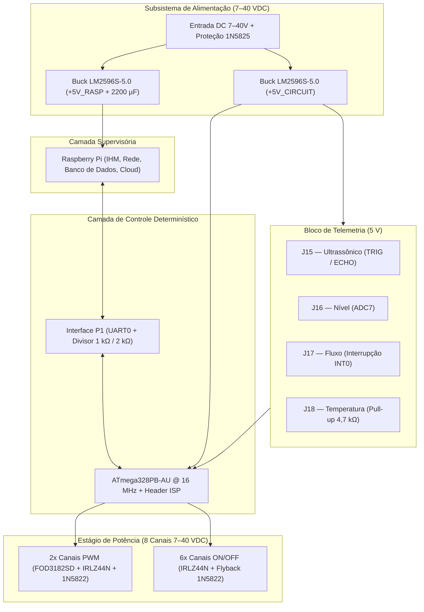
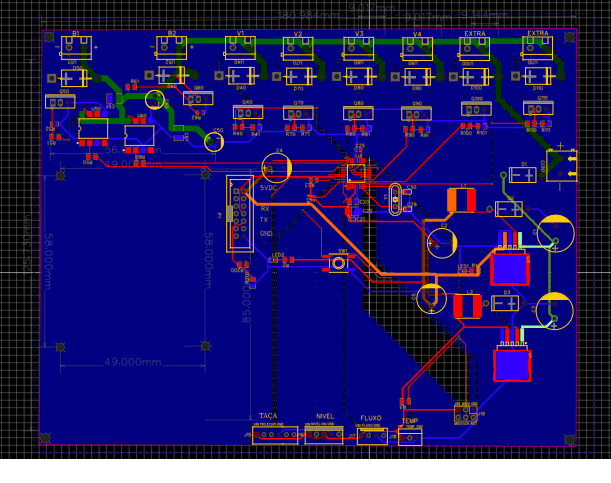

# Raspberry Pi IECE

### Interface Expandida de Controle Eletrônico — Placa de Expansão para Automação e Sistemas Embarcados

---

O **Raspberry Pi IECE** (*Interface Expandida de Controle Eletrônico*) é uma placa de expansão de hardware projetada para integrar computação embarcada de alto nível ao acionamento determinístico de sensores e cargas DC em ambientes de automação, controle de processos e IoT industrial.

A arquitetura desacopla a camada supervisória — executada por um **Raspberry Pi** (IHM, conectividade, telemetria e persistência de dados) — da camada de controle físico em tempo real, gerenciada por um microcontrolador dedicado **ATmega328PB-AU**. Essa separação elimina a dependência direta dos GPIOs do sistema operacional para tarefas críticas de temporização, chaveamento de potência e proteção elétrica.

  
   
  <em>Visualização 3D da placa Raspberry Pi IECE — estágio de potência (topo), regulação buck dupla (direita), núcleo AVR (centro) e barramentos de telemetria (base).</em>

---

## Sumário

1. [Visão Geral e Especificações Técnicas](#visão-geral-e-especificações-técnicas)
2. [Arquitetura do Sistema](#arquitetura-do-sistema)
3. [Subsistema de Alimentação e Integridade Elétrica](#subsistema-de-alimentação-e-integridade-elétrica)
4. [Núcleo de Controle e Interface com Raspberry Pi](#núcleo-de-controle-e-interface-com-raspberry-pi)
5. [Estágio de Potência e Entradas de Telemetria](#estágio-de-potência-e-entradas-de-telemetria)
6. [Projeto de PCB e Critérios de Layout](#projeto-de-pcb-e-critérios-de-layout)
7. [Validação em Bancada e Documentação de Hardware](#validação-em-bancada-e-documentação-de-hardware)
8. [Firmware e Cenários de Aplicação](#firmware-e-cenários-de-aplicação)
9. [Estrutura do Repositório](#estrutura-do-repositório)

---

## Visão Geral e Especificações Técnicas

Em aplicações reais de campo, delegar acionamento de cargas indutivas, geração de PWM e contagem de pulsos diretamente a um Single-Board Computer (SBC) rodando Linux introduz riscos de jitter, instabilidade de alimentação e vulnerabilidade elétrica. O IECE resolve esse problema consolidando regulação de energia isolada, condicionamento de sinais, adaptação de nível lógico e estágio de potência em uma única placa-base com acoplamento mecânico direto para o Raspberry Pi.

| Parâmetro | Especificação |
| :--- | :--- |
| **Microcontrolador** | ATmega328PB-AU (encapsulamento TQFP-32) |
| **Clock Principal** | Cristal externo de 16 MHz com capacitores de carga de 22 pF |
| **Tensão de Entrada** | 7 VDC a 40 VDC (borne `CON1`, proteção reversa Schottky `1N5825`) |
| **Regulação Interna** | 2 conversores Buck independentes `LM2596S-5.0` (`+5V_RASP` e `+5V_CIRCUIT`) |
| **Reserva Capacitiva SBC** | Capacitor eletrolítico bulk de 2200 µF dedicado na linha `+5V_RASP` |
| **Saídas de Potência PWM** | 2 canais DC (7–40 VDC) via optodrivers `FOD3182SD` + MOSFETs `IRLZ44N` |
| **Saídas Digitais ON/OFF** | 6 canais DC (7–40 VDC) via MOSFETs `IRLZ44N` (acionamento lógico 5 V) |
| **Proteção de Cargas** | Diodo Schottky de flyback `1N5822` e pull-down de gate 10 kΩ em todos os 8 canais |
| **Entradas de Telemetria** | 4 barramentos dedicados (Ultrassônico, Nível, Fluxo em `INT0` e Temperatura) |
| **Interface com Host** | Conector `P1` (UART0 + `+5V_RASP` + `GND`) com level shifting 5 V → 3,3 V |
| **Programação de Firmware** | Header ISP 2×3 (`J19`, passo 2,54 mm) e botão de reset físico (`SW1`) |
| **Integração Mecânica** | Furação dedicada de 58 mm × 49 mm para fixação direta do Raspberry Pi |
| **Revisão de Hardware** | Rev. 1.0 (esquemático e layout desenvolvidos em EasyEDA) |

---

## Arquitetura do Sistema

O diagrama abaixo ilustra o fluxo de energia, comunicação e atuação entre os subsistemas da placa:

### Divisão de Responsabilidades

| Camada | Hardware | Responsabilidades |
| :--- | :--- | :--- |
| **Supervisória** | Raspberry Pi (externo, acoplado à PCB) | Interface gráfica local/remota (IHM), serviços web, conectividade de rede, APIs IoT, persistência em banco de dados e orquestração de alto nível. |
| **Controle Embarcado** | ATmega328PB-AU (integrado na PCB) | Leitura determinística de sensores, captura de pulsos por interrupção, geração de PWM, acionamento direto das cargas de potência, operação autônoma e protocolo serial UART com o host. |

---

## Subsistema de Alimentação e Integridade Elétrica

O estágio de alimentação foi dimensionado para operar diretamente a partir de fontes industriais padrão (12 V, 24 V ou 36 V) e sistemas automotivos, cobrindo uma faixa de entrada de **7 VDC a 40 VDC** através do borne de entrada `CON1`.

- **Proteção de Entrada:** diodo Schottky de potência `1N5825` (`D1`) em série protegendo toda a placa contra inversão acidental de polaridade.
- **Topologia de Regulação Dupla Independente:** utilização de dois conversores buck step-down `LM2596S-5.0` (`U3` e `U1`), cada um com filtragem LC dedicada (`680 µF` na entrada, indutor de `68 µH`, diodo de roda-livre `1N5825`, capacitor de saída de `470 µF` e LED indicador de barramento ativo):
  - **Barramento `+5V_RASP` (`U3`):** exclusivo para alimentação do Raspberry Pi, complementado por um capacitor eletrolítico bulk de **2200 µF** (`C4`) posicionado junto ao conector de interface `P1` para absorver transitórios de corrente durante boot e picos de periféricos USB/HDMI.
  - **Barramento `+5V_CIRCUIT` (`U1`):** exclusivo para o microcontrolador `ATmega328PB`, circuitos de reset e sensores de telemetria, mitigando quedas de tensão e ruído de comutação provenientes do SBC.
- **Desacoplamento Multi-Década no MCU:** associação paralela de capacitores de **10 µF (`C22`), 1 µF (`C20`) e 100 nF (`C21`)** posicionada junto aos pinos `VCC`, `AVCC` e `GND` do `ATmega328PB` para filtragem em banda larga.

---

## Núcleo de Controle e Interface com Raspberry Pi

### Processamento Embarcado

- **Microcontrolador `ATmega328PB-AU` (`U4`):** escolhido pela previsibilidade em tempo real, robustez em ambientes ruidosos e compatibilidade direta com toolchains AVR-GCC e ecossistema Arduino.
- **Oscilador e Reset:** cristal externo de **16 MHz** (`Y1`) com capacitores de `22 pF` (`C29`, `C30`); circuito de reset físico via chave táctil `SW1` com pull-up de `10 kΩ` (`R23`) e filtragem RC (`100 Ω` / `100 nF`) para imunidade a disparos espúrios.
- **Gravação In-Circuit:** header **ISP 2×3 (`J19`, passo 2,54 mm)** expondo `MOSI`, `MISO`, `SCK`, `RST`, `+5V_CIRCUIT` e `GND`, permitindo atualização de firmware e configuração de fuses sem remoção de componentes.

### Comunicação Serial e Integração Mecânica

- **Interface de Comandos (`P1`):** conector `HDR-IDC 2×7` (passo 2,54 mm) reunindo `+5V_RASP`, `GND`, `TX` e `RX` em um único ponto de conexão com o Raspberry Pi.
- **Adaptação de Nível Lógico (Level Shifting):** a linha `TX` do `ATmega328PB` (5 V) passa por um divisor resistivo dedicado (`R200 = 1 kΩ` / `R201 = 2 kΩ`), reduzindo o sinal para **3,33 V** antes da entrada `RX` do Raspberry Pi e protegendo os GPIOs não tolerantes a 5 V. A linha reversa (`TX` do Raspberry Pi em 3,3 V → `RX` do AVR) opera diretamente dentro da margem lógica alta do ATmega328PB.
- **Acoplamento Mecânico:** a PCB incorpora o padrão de furação **58 mm × 49 mm** para fixação rígida do Raspberry Pi diretamente sobre a placa, encurtando chicotes de comunicação e alimentação.

---

## Estágio de Potência e Entradas de Telemetria

### Estágio de Potência — 8 Canais DC (7 a 40 VDC)

Todos os canais de saída utilizam MOSFETs N-Channel *logic-level* **`IRLZ44N`** conectados a bornes individuais (`KF301-5.0-2P`), equipados com **diodos Schottky de flyback `1N5822`** para supressão de picos indutivos e **resistores de pull-down de `10 kΩ`** no gate para garantir estado desligado seguro durante o reset ou inicialização do microcontrolador.

| Grupo de Canais | Identificação na PCB | Arquitetura do Driver | Componentes-Chave | Aplicações Típicas |
| :--- | :--- | :--- | :--- | :--- |
| **2 Canais PWM Isolados** | `B1`, `B2` (`D2`, `D3`) | Optodriver de gate de alta velocidade | `FOD3182SD`, `Rg = 10 Ω`, `Rpd = 10 kΩ`, desacoplamento `1 µF + 100 nF`, `IRLZ44N`, `1N5822` | Controle proporcional, velocidade de motores DC, bombas dosadoras e controle de brilho |
| **6 Canais Digitais ON/OFF** | `V1`–`V4`, `EXTRA` ×2 (`D1`, `D4`–`D8`) | Acionamento direto em lógica 5 V | `Rg = 220 Ω`, `Rpd = 10 kΩ`, `IRLZ44N`, `1N5822` | Válvulas solenoides, relés, bombas auxiliares, ventiladores e cargas resistivas |

### Interfaces de Telemetria — 4 Barramentos Dedicados

Todos os conectores de sensores são alimentados pelo barramento isolado **`+5V_CIRCUIT`** e posicionados na borda inferior da placa para roteamento limpo em painel.

| Conector | Tipo | Sinais | Pino no MCU | Aplicação e Condicionamento |
| :--- | :--- | :--- | :--- | :--- |
| **`J15`** | `FG-2510-6A` (6 vias) | `+5V_CIRCUIT`, `TRIG`, `ECHO`, `GND` | `PC1` / `PC0` | Sensores ultrassônicos de distância, presença e medição de nível |
| **`J16`** | `KF2510-5A` (5 vias) | `+5V_CIRCUIT`, `NIVEL`, `GND` | `PE3 (ADC7)` | Sensores analógicos ou digitais de nível em reservatórios |
| **`J17`** | `1474674-1` (4 vias) | `+5V_CIRCUIT`, `FLUXO`, `GND` | `PD2 (INT0)` | Sensores de fluxo por pulso com captura determinística via interrupção externa |
| **`J18`** | `2510-3A` (3 vias) | `+5V_CIRCUIT`, `TEMP`, `GND` | `PE2 (ADC6)` | Sensores térmicos (pull-up integrado `R3 = 4,7 kΩ` pronto para 1-Wire / DS18B20 ou divisores resistivos) |

---

## Projeto de PCB e Critérios de Layout

  
   
  <em>Layout completo da placa evidenciando o particionamento entre potência, regulação, lógica e zona mecânica do Raspberry Pi.</em>

O roteamento da PCB foi estruturado em zonas funcionais bem definidas para preservar integridade de sinal, dissipação térmica e facilidade de manutenção:

- **Segregação entre Potência e Lógica:** os 8 MOSFETs `IRLZ44N`, diodos de flyback e bornes de saída ocupam integralmente a borda superior da placa, mantendo loops de alta corrente distantes do microcontrolador e das linhas de telemetria.
- **Barramento de Corrente Dimensionado:** trilhas reforçadas para a alimentação `7–40 VDC` e retorno de massa dos estágios buck e de potência, reduzindo impedância parasita e queda de tensão sob carga.
- **Agrupamento de Regulação:** os dois estágios `LM2596S-5.0`, indutores e eletrolíticos de filtragem concentram-se na lateral direita, próximo ao borne de entrada `CON1`, minimizando a área de malha de chaveamento.
- **Núcleo Compacto e Periféricos de Borda:** cristal de `16 MHz` e capacitores de desacoplamento posicionados imediatamente junto ao `ATmega328PB-AU`; conectores de sensores (`J15`–`J18`) e programação (`J19`) alinhados na borda inferior para facilitar chicoteamento e diagnóstico em campo.

---

## Validação em Bancada e Documentação de Hardware

> [!NOTE]
> **Esquemático Elétrico Completo:** a documentação de circuito em alta resolução (Revisão 1.0, contendo referências de componentes, valores nominais e mapeamento completo de sinais) está disponível em [`Esquematico-OTWM.pdf`](./Esquematico-OTWM.pdf).

O projeto percorreu o ciclo completo de engenharia de hardware — da concepção esquemática e layout até a fabricação da PCB, montagem dos componentes SMD/THT e validação elétrica e funcional em bancada integrada a um Raspberry Pi e interface gráfica em display HDMI.

<table>
  <tr>
    <td align="center" width="50%">
      
       
      <em>Protótipo fabricado e montado em suporte de bancada com Raspberry Pi acoplado mecanicamente, barramento UART conectado e rails de 5 V energizados.</em>
    </td>
    <td align="center" width="50%">
      
       
      <em>Validação funcional completa em bancada: fonte chaveada externa, medição de tensões e operação integrada com aplicação IHM em tela HDMI.</em>
    </td>
  </tr>
</table>

---

## Firmware e Cenários de Aplicação

### Desenvolvimento e Operação

O firmware embarcado no `ATmega328PB-AU` pode ser desenvolvido em **C/C++**, **AVR-GCC** ou **Framework Arduino AVR** (com suporte à variante `ATmega328PB`), gravado diretamente via header ISP (`J19`). A arquitetura suporta três modos de operação:

1. **Integrado ao Raspberry Pi:** o SBC atua como IHM, gateway de rede e camada de negócios, enviando comandos e recebendo telemetria estruturada via UART.
2. **Operação Autônoma:** o `ATmega328PB` executa malhas locais de controle (fluxo, nível, temperatura e acionamento de cargas) independentemente de um host ativo.
3. **Integração SCADA / IoT:** compatível com exposição via APIs REST, MQTT ou protocolos industriais executados na camada do Raspberry Pi.

### Domínios de Aplicação

| Domínio | Casos de Uso |
| :--- | :--- |
| **Automação de Processos e Dosagem** | Controle volumétrico de líquidos por sensor de fluxo (`INT0`), acionamento de válvulas solenoides e bombas com modulação PWM e controle térmico. |
| **Automação Industrial e SCADA** | Controladores dedicados de máquinas, interfaces homem-máquina (IHM) embarcadas, acionamento de atuadores DC até 40 V e supervisão local/remota. |
| **IoT Industrial e Telemetria** | Gateways de aquisição de dados em campo com pré-processamento determinístico no MCU e envio em nuvem pelo Raspberry Pi. |
| **Sistemas Hidráulicos e Agrícolas** | Monitoramento de reservatórios por ultrassom/nível, irrigação automatizada e gestão de bombas com proteção de cargas indutivas. |

---

## Estrutura do Repositório

| Arquivo | Descrição |
| :--- | :--- |
| [`Esquematico-OTWM.pdf`](./Esquematico-OTWM.pdf) | Esquemático elétrico completo (Rev. 1.0 — EasyEDA) |
| [`PCB_LAYOUT.png`](./PCB_LAYOUT.png) | Vista de layout e roteamento da placa de circuito impresso |
| [`PCB_3D.png`](./PCB_3D.png) | Renderização 3D da placa montada |
| [`PCB-Fabricada.jfif`](./PCB-Fabricada.jfif) | Registro fotográfico da PCB fabricada em teste com Raspberry Pi |
| [`PCB-Fabricada-2.jfif`](./PCB-Fabricada-2.jfif) | Validação funcional integrada com IHM em display HDMI |
| [`Readme.md`](./Readme.md) | Documentação técnica do projeto |

---

  Hardware projetado e validado por <strong>Aislan Silva Costa</strong> — Revisão 1.0

